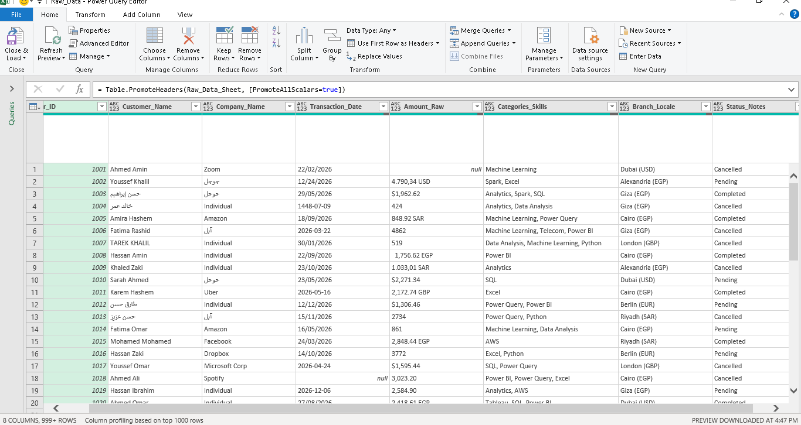
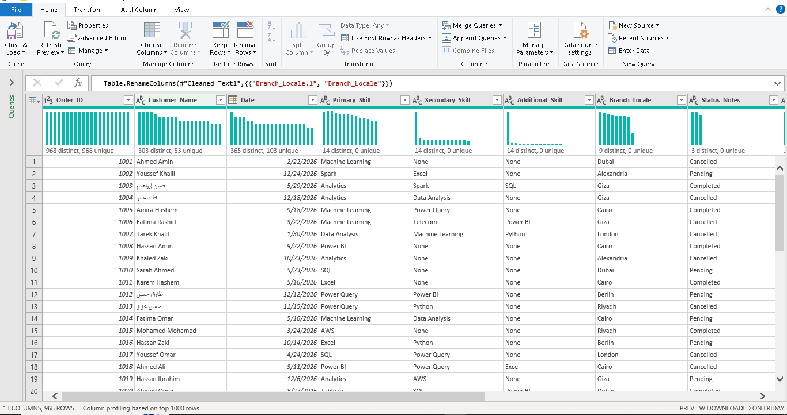
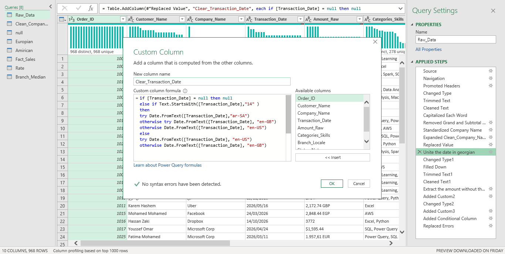
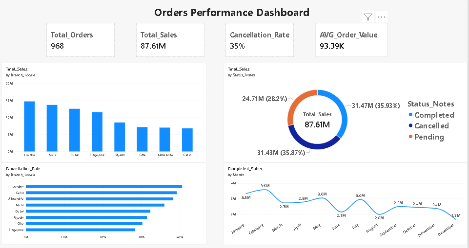
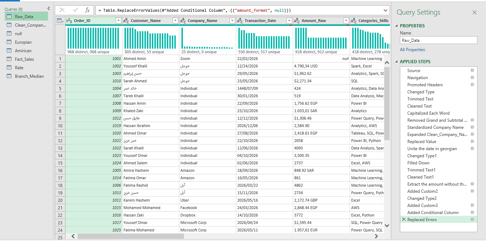

# Sales Data Cleaning & Analysis with Power Query and Power BI
**Note:** This project uses a synthetic dataset. The focus is on data cleaning techniques in Power Query, not on business insights.

Cleaning a messy sales dataset (12 data-quality issues) using Power Query, then building an interactive Power BI dashboard on the cleaned data.

## 📌 Project Overview
The raw dataset contained inconsistent date formats, mixed currencies, multilingual names, duplicate and subtotal rows, and missing values. This project transforms it into an analysis-ready table and visualizes the key sales metrics.

- **Raw records:** 1,000
- **Clean records:** 968
- **Tools:** Power Query (M), Power BI

## 📂 Repository Structure
```
├── 01_Data/          Raw and cleaned datasets
├── 02_Power Query/   M code for each query
├── 03_Power BI/      Power BI dashboard (.pbix)
└── 04_Assets/        Screenshots
```

## 🧹 Data Cleaning Steps

| Before Cleaning | After Cleaning |
|---|---|
|  |  |

- **Dates:** The `Transaction_Date` column mixed Gregorian and Hijri dates with different separators (e.g. `22/02/2026`, `2026-05-16`, `1448-07-09`). Using **Power Query (M)**, I:
  - Replaced `-` separators with `/` using `Table.ReplaceValue`.
  - Detected Hijri dates (values starting with `14`) and converted them to Gregorian using `Date.FromText` with the `ar-SA` locale.
  - Parsed the remaining dates with a `try ... otherwise` fallback chain (`en-US`, then `en-GB`) so every row has a single `date` value.
  - Filled missing dates from the previous row with `Table.FillDown`.



- **Currencies:** Amounts contained the currency and number mixed in one text field (e.g. `$1,962.62`, `2,848.44 EGP`, `4.790,34 USD`). Using **Power Query (M)**, I:
  - Extracted the numeric part with `Text.Select`.
  - Detected the decimal format (European `4.790,34` vs. American `4,790.34`) by comparing the positions of the last comma and dot with `Text.PositionOf`.
  - Identified the currency code with `Text.Contains`.
  - Converted all amounts to EGP by joining the Rate table with `Table.NestedJoin` and multiplying by the rate.

- **Company names:** Company names appeared in Arabic and English, with typos and variants (e.g. `جوجل`, `Google LLC`, `Micro soft`, `Microsoft Corp`). Using **Power Query (M)**, I:
  - Cleaned the text with `Text.Trim`, `Text.Clean` and `Text.Proper`.
  - Mapped each variant to a standard name (`google`, `microsoft`, `amazon`, `facebook`, `apple`) with a conditional column (`Table.AddColumn`).
  - Joined the result back to the main table with `Table.NestedJoin`.

- **Totals & missing values:** The raw sheet included `GRAND_TOTAL_ROW` and `SUBTOTAL_ROW` rows, which are not real transactions. Using **Power Query (M)**, I:
  - Removed them with `Table.SelectRows`.
  - Filled missing amounts with the **median sales per branch**, using `Table.NestedJoin` against a `Branch_Median` query.
  - Flagged every filled row in the `Amount_Imput` column so it can be filtered out during analysis.

- **Categories/Skills:** The `Categories_Skills` column stored several skills in one text cell, separated by commas (e.g. `Analytics, Spark, SQL`), and some cells were empty. Using **Power Query (M)**, I:
  - Replaced empty values with `Not Specified` using `Table.ReplaceValue`.
  - Split the column by comma into three columns.
  - Renamed the new columns to `Primary_Skill`, `Secondary_Skill` and `Additional_Skill`.
  - Replaced the missing secondary and additional skills with `None`, then cleaned the text with `Text.Trim` and `Text.Clean`.

## ⚠️ Limitations

- **Synthetic data:** The dataset was generated for practice, so the values, branch distribution and sales patterns do not reflect a real business. Because of this, the analysis insights are limited and should not be treated as business conclusions.
- **Focus of the project:** The main focus is the **data cleaning process**, handling 12 data-quality issues with Power Query, rather than deep business analysis.
- **Assumptions:** Missing amounts were filled with the branch median, and exchange rates are fixed values from the Rate table, not live rates.
- **Mixed names:** The same customer may appear in both Arabic and English.

## 📊 Dashboard


The dashboard contains 4 KPI cards and 4 charts (donut, column, line, bar).

**Key insights:**
- Total sales reached 87.61M across 968 orders, but Completed (31.47M) and Cancelled (31.43M) sales are almost equal, which makes the cancellation rate (35%) a significant issue.
- London has the highest cancellation rate (around 40%), while Singapore has the lowest (around 28%).
- Completed sales peaked in February (3.6M) and dropped to their lowest in August (2.0M).

## 🛠️ How It Was Built



## 🚀 How to Run
1. Open `03_Power BI/DashBoard.pbix` in Power BI Desktop.
2. To reproduce the cleaning, open the M code files in `02_Power Query/` in Power Query Editor.
   > Note: update the file path in the code to point to your local copy of the raw data.

## 👤 Author
**Mahmoud Ahmed Abdelhamid**
[LinkedIn](https://www.linkedin.com/in/mahmoud-abdelhamid-844ab6439) | [Email](mailto:mahmoud.abdelhamid0313@gmail.com)
